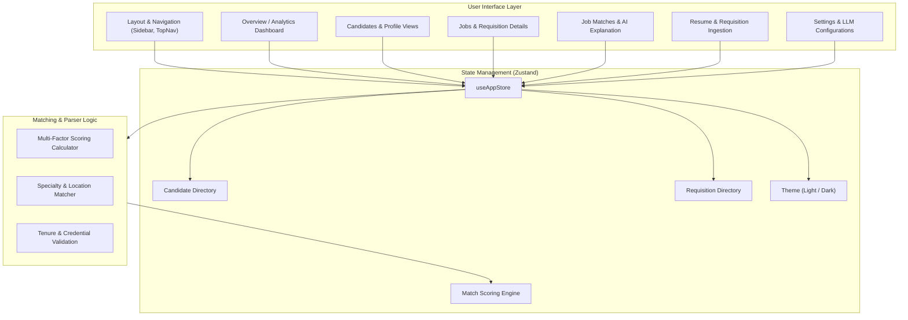

<div align="center">
  
  <h1 align="center">TalentFlow ATS</h1>
  <p align="center">
    <strong>Intelligent Healthcare & Clinical Staffing Applicant Tracking System powered by React, TypeScript, Vite & Zustand</strong>
  </p>

  <p align="center">
    <a href="https://react.dev/"></a>
    <a href="https://www.typescriptlang.org/"></a>
    <a href="https://vitejs.dev/"></a>
    <a href="https://tailwindcss.com/"></a>
    <a href="https://github.com/pmndrs/zustand"></a>
    <a href="https://lucide.dev/"></a>
  </p>

  <p align="center">
    <a href="#-overview">Overview</a> •
    <a href="#-key-features">Key Features</a> •
    <a href="#-architecture">Architecture</a> •
    <a href="#-tech-stack">Tech Stack</a> •
    <a href="#-getting-started">Getting Started</a> •
    <a href="#-project-structure">Project Structure</a> •
    <a href="#-author">Author</a>
  </p>
</div>

---

## 📖 Overview

**TalentFlow ATS** is an enterprise-grade Applicant Tracking & Intelligent Staff Matching platform designed specifically for specialized talent acquisition, travel nursing, and healthcare recruiting. 

Traditional applicant tracking tools struggle with multi-state licensing, credential matching, and clinical experience timelines. TalentFlow solves this by automating the parsing, scoring, and matching of candidates to hospital facility openings with transparent fit-score breakdowns, recruiter verification workflows, and lightning-fast client-side state management.

---

## ✨ Key Features

### 🎯 1. Explainable AI Match Engine
- **Multi-Factor Scoring**: Evaluates candidate fit across specialty alignment, clinical experience tenure, travel location affinity, and credential requirements.
- **Transparent Breakdown**: Provides recruiters with a human-readable explanation and percentage scores for each factor rather than opaque black-box recommendations.
- **Workflow Actioning**: Instant one-click statuses (`pending`, `reviewed`, `accepted`, `rejected`) with interactive filtering.

### 👩‍⚕️ 2. Comprehensive Candidate CRM
- **Detailed Clinical Profiles**: Past assignment history, hospital facilities, travel destinations, and certification records.
- **Recruiter Verification**: Recruiter validation badges to separate verified medical talent from unreviewed submissions.
- **Multi-Parametric Search**: Filter candidate pools by specialty (ICU, Emergency, Orthopedics, Med/Surg, etc.), experience years, and placement status.

### 🏥 3. Requisition & Job Management
- **Facility Openings**: Real-time tracking of active and draft requisitions across medical centers and health systems.
- **Detailed Requisition View**: Dynamic matching linking open positions directly with ranked candidate pools.
- **Batch Job & Resume Import**: Ingestion pipeline simulation with step-by-step parsing progress.

### 📊 4. Executive Analytics & Dashboard
- **Key Recruitment Metrics**: Active pipelines, candidate conversion, match accuracy, and placement speed.
- **Interactive Visualizations**: Stage breakdowns, recent matches, and operational activity streams.

### 🎨 5. Sleek Design & Ergonomics
- **Dark & Light Mode**: Built-in high-contrast theme support tailored for long recruiting sessions.
- **Keyboard-Friendly & Accessible**: Rapid navigation and fluid UI feedback powered by Tailwind CSS tokens.

---

## 🏛️ Architecture

TalentFlow leverages a modular client-side architecture with reactive state synchronized via Zustand:



---

## 🛠️ Tech Stack

| Domain | Technology | Purpose |
| :--- | :--- | :--- |
| **Framework** | [React 18](https://react.dev/) | Declarative component UI architecture |
| **Language** | [TypeScript 5.7](https://www.typescriptlang.org/) | Full type safety across models and stores |
| **Build Tool** | [Vite 6](https://vitejs.dev/) | Sub-second HMR and optimized asset bundling |
| **Styling** | [Tailwind CSS 4](https://tailwindcss.com/) | Modern atomic styles, theme tokens, and responsive utilities |
| **State** | [Zustand 5](https://github.com/pmndrs/zustand) | Lightweight, boilerplate-free global store |
| **Icons** | [Lucide React](https://lucide.dev/) | Clean, consistent SVG icon set |
| **Charts** | [Recharts 2](https://recharts.org/) | Composable SVG data visualizations |
| **Drag & Drop** | [@dnd-kit](https://dndkit.com/) | Extensible drag-and-drop primitives |
| **Animations** | [Framer Motion](https://www.framer.com/motion/) | Smooth page transitions and micro-interactions |

---

## 🚀 Getting Started

### Prerequisites
- **Node.js**: v18.0.0 or higher
- **npm**: v9.0.0 or higher

### Installation

1. **Clone or navigate into the repository**:
   ```bash
   cd Projects/Talent-Match
   ```

2. **Install project dependencies**:
   ```bash
   npm install
   ```

3. **Start the local development server**:
   ```bash
   npm run dev
   ```

4. **Open in browser**:
   Navigate to `http://localhost:5173` to view the application.

### Available Scripts

| Command | Action |
| :--- | :--- |
| `npm run dev` | Starts Vite local development server with hot-module reload |
| `npm run build` | Builds optimized production bundle in `dist/` |
| `npm run typecheck` | Executes TypeScript type checking (`tsc --noEmit`) |

---

## 📁 Project Structure

```
Talent-Match/
├── index.html              # HTML entry template & typography configuration
├── package.json            # Scripts, dependencies, and project metadata
├── tsconfig.json           # TypeScript configuration
├── vite.config.js          # Vite plugins and build options
├── src/
│   ├── main.tsx            # Application bootstrapping & root DOM rendering
│   ├── App.tsx             # Root routing router & theme wrapper
│   ├── index.css           # Global design system tokens, themes, & utility classes
│   ├── components/         # Reusable UI components
│   │   └── Layout.tsx      # App shell with sidebar, notifications, and navigation
│   ├── data/               # Seed datasets
│   │   └── mockData.ts     # Realistic candidate, requisition, and match datasets
│   ├── pages/              # Application views
│   │   ├── Overview.tsx    # Pipeline analytics & recruitment overview
│   │   ├── Candidates.tsx  # Candidate catalog with search & filter drawers
│   │   ├── CandidateProfile.tsx # Detailed clinical resume & assignment timeline
│   │   ├── Jobs.tsx        # Job requisition directory
│   │   ├── JobDetail.tsx   # Facility requisition spec & matched candidates
│   │   ├── JobMatches.tsx  # Explainable AI matching & score analysis
│   │   ├── ResumeImport.tsx# Bulk resume parser ingestion simulator
│   │   ├── JobImport.tsx   # Bulk requisition importer
│   │   └── Settings.tsx    # Integration options, LLM provider, and preferences
│   ├── store/
│   │   └── index.ts        # Zustand store holding applications, jobs, & filters
│   └── types/
│       └── index.ts        # Type definitions for Candidates, Jobs, Matches, etc.
```

---

## 🛡️ Security & Quality Standards

- **Zero Secret Leaks**: Configured `.gitignore` for `.env` credentials, build output, and local operating system files.
- **Clean Git Lineage**: Authorship correctly attributed to repository maintainers for clean GitHub contribution analytics.
- **Type Safety**: Strictly checked TypeScript types with zero compiler errors.

---

## 👤 Author

- **Developer**: [Abhishek Jain](https://github.com/codewithabhiishek)
- **Email**: socials.abhiishek@gmail.com
