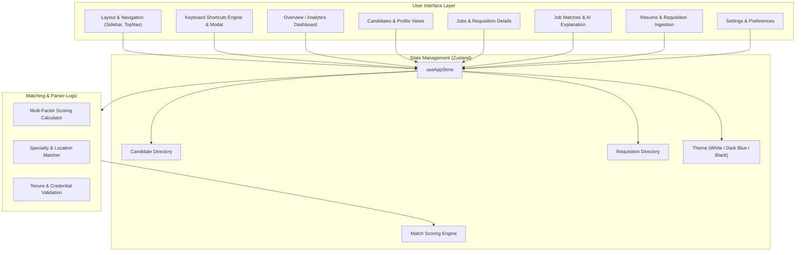

<div align="center">
  
  <h1 align="center">TalentFlow ATS</h1>
  <p align="center">
    <strong>Enterprise Healthcare & Clinical Staffing Applicant Tracking System powered by React, TypeScript, Vite & Zustand</strong>
  </p>

  <p align="center">
    <a href="https://react.dev/"></a>
    <a href="https://www.typescriptlang.org/"></a>
    <a href="https://vitejs.dev/"></a>
    <a href="https://tailwindcss.com/"></a>
    <a href="https://github.com/pmndrs/zustand"></a>
    <a href="https://lucide.dev/"></a>
  </p>

  <p align="center">
    <a href="#-overview">Overview</a> •
    <a href="#-key-features">Key Features</a> •
    <a href="#-keyboard-shortcuts">Keyboard Shortcuts</a> •
    <a href="#-themes">Themes</a> •
    <a href="#-architecture">Architecture</a> •
    <a href="#-tech-stack">Tech Stack</a> •
    <a href="#-getting-started">Getting Started</a> •
    <a href="#-project-structure">Project Structure</a> •
    <a href="#-author">Author</a>
  </p>
</div>

---

## 📖 Overview

**TalentFlow ATS** is an enterprise-grade Applicant Tracking & Intelligent Staff Matching platform designed specifically for specialized talent acquisition, travel nursing, and healthcare recruiting. 

Traditional applicant tracking tools struggle with multi-state licensing, credential matching, and clinical experience timelines. TalentFlow solves this by automating the parsing, scoring, and matching of candidates to hospital facility openings with transparent fit-score breakdowns, recruiter verification workflows, universal keyboard ergonomics, and lightning-fast client-side state management.

---

## ✨ Key Features

### 🎯 1. Explainable AI Match Engine
- **Multi-Factor Scoring**: Evaluates candidate fit across specialty alignment, clinical experience tenure, travel location affinity, and credential requirements.
- **Transparent Breakdown**: Provides recruiters with a human-readable explanation and percentage scores for each factor rather than opaque black-box recommendations.
- **Workflow Actioning**: Instant one-click statuses (`pending`, `reviewed`, `accepted`, `rejected`) with interactive filtering.

### 👩‍⚕️ 2. Comprehensive Candidate CRM
- **Detailed Clinical Profiles**: Past assignment history, hospital facilities, travel destinations, and certification records.
- **Recruiter Verification**: Recruiter validation badges to separate verified medical talent from unreviewed submissions.
- **Multi-Parametric Search**: Filter candidate pools by specialty (ICU, Emergency, Orthopedics, Med-Surg, etc.), experience years, and placement status.

### 🏥 3. Requisition & Job Management
- **Facility Openings**: Real-time tracking of active, draft, and filled requisitions across medical centers and health systems.
- **Detailed Requisition View**: Dynamic matching linking open positions directly with ranked candidate pools.
- **Batch Job & Resume Import**: Ingestion pipeline simulation with step-by-step parsing progress.

### 📊 4. Executive Analytics & Dashboard
- **Key Recruitment Metrics**: Active pipelines, candidate conversion, match accuracy, and placement speed.
- **Interactive Visualizations**: Weekly activity trends, stage breakdowns, recent matches, and operational activity streams.

### ⚡ 5. Universal Keyboard Shortcuts
- **Power-Recruiter Ergonomics**: Universal bindings for macOS (<kbd>⌘</kbd> / <kbd>⌥</kbd>) and Windows / Linux (<kbd>Ctrl</kbd> / <kbd>Alt</kbd>).
- **Sequence Navigation**: Linear / GitHub-style two-key jumps (<kbd>G</kbd> then <kbd>O</kbd>, <kbd>C</kbd>, <kbd>J</kbd>, <kbd>M</kbd>, <kbd>R</kbd>, <kbd>S</kbd>) with real-time feedback indicator.
- **Instant Search**: <kbd>⌘K</kbd> / <kbd>Ctrl+K</kbd> or <kbd>/</kbd> anywhere.
- **Interactive Cheat Sheet**: Press <kbd>?</kbd> anytime to open the modal cheat sheet.

### 🎨 6. High-Contrast Enterprise Themes
- **White Theme**: Crisp, high-contrast light mode for daytime recruiting.
- **Dark Blue Theme**: Deep slate/navy palette reducing eye strain during high-volume screen time.
- **Pure Black (OLED) Theme**: True pitch-black `#000000` surface with emerald and sky accents for maximum contrast and battery conservation.

---

## ⌨️ Keyboard Shortcuts

TalentFlow ATS includes universal keyboard shortcuts that adapt to your operating system:

| Action | macOS Shortcut | Windows & Linux Shortcut |
| :--- | :--- | :--- |
| **Global Search** | <kbd>⌘</kbd> + <kbd>K</kbd> or <kbd>/</kbd> | <kbd>Ctrl</kbd> + <kbd>K</kbd> or <kbd>/</kbd> |
| **Shortcuts Cheat Sheet** | <kbd>?</kbd> (Shift + `/`) | <kbd>?</kbd> (Shift + `/`) |
| **Dismiss / Clear** | <kbd>Esc</kbd> | <kbd>Esc</kbd> |
| **Toggle Sidebar** | <kbd>⌘</kbd> + <kbd>B</kbd> or <kbd>B</kbd> | <kbd>Ctrl</kbd> + <kbd>B</kbd> or <kbd>B</kbd> |
| **Cycle Theme** | <kbd>T</kbd> or <kbd>⌥</kbd> + <kbd>T</kbd> | <kbd>T</kbd> or <kbd>Alt</kbd> + <kbd>T</kbd> |
| **Go to Overview** | <kbd>G</kbd> then <kbd>O</kbd> *(or <kbd>⌥1</kbd>)* | <kbd>G</kbd> then <kbd>O</kbd> *(or <kbd>Alt+1</kbd>)* |
| **Go to Candidates** | <kbd>G</kbd> then <kbd>C</kbd> *(or <kbd>⌥2</kbd>)* | <kbd>G</kbd> then <kbd>C</kbd> *(or <kbd>Alt+2</kbd>)* |
| **Go to Jobs** | <kbd>G</kbd> then <kbd>J</kbd> *(or <kbd>⌥3</kbd>)* | <kbd>G</kbd> then <kbd>J</kbd> *(or <kbd>Alt+3</kbd>)* |
| **Go to Job Matches** | <kbd>G</kbd> then <kbd>M</kbd> *(or <kbd>⌥4</kbd>)* | <kbd>G</kbd> then <kbd>M</kbd> *(or <kbd>Alt+4</kbd>)* |
| **Go to Resume Imports** | <kbd>G</kbd> then <kbd>R</kbd> *(or <kbd>⌥5</kbd>)* | <kbd>G</kbd> then <kbd>R</kbd> *(or <kbd>Alt+5</kbd>)* |
| **Go to Settings** | <kbd>G</kbd> then <kbd>S</kbd> *(or <kbd>⌥6</kbd>)* | <kbd>G</kbd> then <kbd>S</kbd> *(or <kbd>Alt+6</kbd>)* |
| **New Candidate** | <kbd>N</kbd> | <kbd>N</kbd> |
| **Import Files** | <kbd>I</kbd> | <kbd>I</kbd> |

> **Note:** Single-letter shortcuts are automatically suppressed while typing in form inputs, search fields, or text areas.

---

## 🎨 Themes

TalentFlow ATS features three refined themes toggleable via the header button, Settings, or <kbd>T</kbd>:

1. **White**: Clean neutral aesthetic for brightly-lit offices.
2. **Dark Blue**: Low-glare slate and navy styling for standard workstation use.
3. **Pure Black (OLED)**: Pitch-black background (`#000000`) with high-contrast text and border tokens for modern OLED displays.

---

## 🏛️ Architecture



---

## 🛠️ Tech Stack

| Domain | Technology | Purpose |
| :--- | :--- | :--- |
| **Framework** | [React 18](https://react.dev/) | Declarative component UI architecture |
| **Language** | [TypeScript 5.7](https://www.typescriptlang.org/) | Strict type safety across models and stores |
| **Build Tool** | [Vite 6](https://vitejs.dev/) | Instant HMR and optimized asset bundling |
| **Styling** | [Tailwind CSS 4](https://tailwindcss.com/) | Theme tokens, custom variables, and responsive design |
| **State** | [Zustand 5](https://github.com/pmndrs/zustand) | Global reactive state with local persistence |
| **Icons** | [Lucide React](https://lucide.dev/) | Consistent SVG icon system |
| **Charts** | [Recharts 2](https://recharts.org/) | Composable SVG data visualizations |

---

## 🚀 Getting Started

### Prerequisites
- **Node.js**: v18.0.0 or higher
- **npm**: v9.0.0 or higher

### Installation

1. **Clone the repository**:
   ```bash
   git clone https://github.com/codewithabhiishek/TalentMatch.git
   cd TalentMatch
   ```

2. **Install dependencies**:
   ```bash
   npm install
   ```

3. **Start the development server**:
   ```bash
   npm run dev
   ```

4. **Open in your browser**:
   Navigate to `http://localhost:5173` to view the application.

### Available Scripts

| Command | Action |
| :--- | :--- |
| `npm run dev` | Starts Vite local development server with hot-module reload |
| `npm run build` | Builds optimized production bundle in `dist/` |
| `npm run typecheck` | Executes TypeScript type checking (`tsc --noEmit`) |

---

## 📁 Project Structure

```
Talent-Match/
├── index.html              # HTML entry template & typography configuration
├── public/
│   ├── logo.svg            # Vector brand logo asset
│   └── favicon.svg         # Tab verified favicon
├── src/
│   ├── main.tsx            # Application bootstrapping & root DOM rendering
│   ├── App.tsx             # Root routing router & theme manager
│   ├── index.css           # Global design system tokens, themes, & utility classes
│   ├── components/         # Reusable UI components
│   │   ├── Layout.tsx      # App shell with header, sidebar, and controls
│   │   ├── KeyboardShortcutsModal.tsx # Interactive shortcuts cheat sheet modal
│   │   └── ShortcutSequenceIndicator.tsx # Real-time key sequence toast
│   ├── hooks/
│   │   └── useKeyboardShortcuts.ts   # Universal keyboard event listener & platform detector
│   ├── data/
│   │   └── mockData.ts     # Realistic candidate, requisition, and match datasets
│   ├── pages/
│   │   ├── Overview.tsx    # Pipeline analytics & recruitment overview
│   │   ├── Candidates.tsx  # Candidate catalog with search & filter toolbar
│   │   ├── CandidateProfile.tsx # Detailed clinical resume & assignment timeline
│   │   ├── Jobs.tsx        # Job requisition directory & metric cards
│   │   ├── JobDetail.tsx   # Facility requisition spec & matched candidates
│   │   ├── JobMatches.tsx  # Explainable AI matching & score analysis
│   │   ├── ResumeImport.tsx# Bulk resume parser ingestion simulator
│   │   ├── JobImport.tsx   # Bulk requisition importer
│   │   └── Settings.tsx    # Settings, appearances, and shortcuts guide
│   ├── store/
│   │   └── index.ts        # Zustand store holding applications, jobs, & filters
│   └── types/
│       └── index.ts        # Type definitions for Candidates, Jobs, Matches, etc.
```

---

## 🛡️ Security & Quality Standards

- **Zero Secret Leaks**: Strict `.gitignore` boundaries ensuring zero credentials or temporary files are tracked.
- **Clean Git Lineage**: Authorship correctly attributed to repository maintainers for clean GitHub contribution analytics.
- **Full Type Safety**: Strictly checked TypeScript types with zero compiler warnings or errors.

---

## 👤 Author

- **Developer**: [Abhishek Jain](https://github.com/codewithabhiishek)
- **GitHub**: [@codewithabhiishek](https://github.com/codewithabhiishek)
- **Email**: socials.abhiishek@gmail.com
